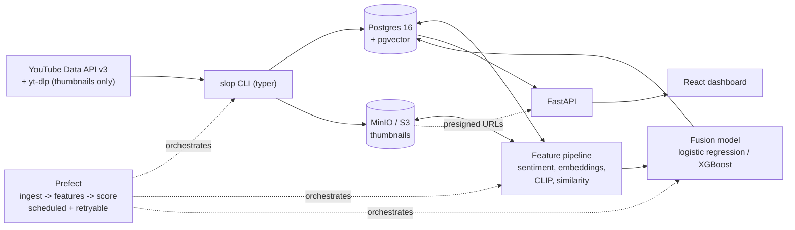

# Slop-or-Not

A YouTube content-quality classifier: given a channel, ingest its videos, score each one
"slop" or "not" using metadata, comment sentiment, thumbnail embeddings, and cross-video
similarity, then browse and label results through a web dashboard. You can also paste a
single YouTube link and get a score for it. Full design and phased plan:
[ROADMAP.md](ROADMAP.md). Where implementation diverged from the plan and why:
[DEVIATIONS.md](DEVIATIONS.md). Stage-by-stage build notes for every phase, plus a
running list of manual/external setup steps and what is left to do:
[docs/writeups/](docs/writeups/) (start with [TODO.md](docs/writeups/TODO.md)).

**Status (2026-10-26):** every roadmap phase (0 to 8) is built. The app has been deployed
to real AWS once (2026-10-20) and verified there as a public, read-only copy; it is not
kept running because it costs money (see Deployment). The open work is more labeled
channels, trying other models, and security hardening (TODO.md items 22 and 24).

## What "slop" means here

Slop is content optimized to capture attention or watch time with as little effort as
possible, at the expense of being honest, original, or informative about what it
actually delivers - a mismatch between what a video promises (title, thumbnail, upload
pattern) and what it actually gives a viewer, not a proxy for low budget or low polish.
The classifier looks for four signal categories: mass-produced/templated content,
misleading thumbnail-title mismatches, low information density, and (as an explicit
counterweight) what's NOT slop - a consistent format, an earned narrative device, or a
low-budget video that's still honest about what it is. The full rubric, including
worked examples and edge-case tie-breakers, lives in [docs/rubric.md](docs/rubric.md) -
it's the operational definition the whole pipeline is trying to predict, and it was
revised once after the first ~50 real labels surfaced cases the first draft didn't
anticipate. Labels are applied per channel (a small random sample of each channel's
videos gets one judgment), a deliberate change from the roadmap's per-video plan; see
[DEVIATIONS.md](DEVIATIONS.md).

## Architecture



Every table uses YouTube's own ids as primary keys; there are no ORM `relationship()`s
anywhere in the codebase, only explicit joins. Object storage (thumbnails) and the
relational/vector store (everything else) are the same API locally (MinIO) and in
production (real S3) - only the endpoint/credentials change, per Phase 0's "12-factor
from day one" design goal.

| Layer | Built in | What it does |
|---|---|---|
| Ingestion (`src/sloppy/ingest/`) | Phase 1 | YouTube Data API for metadata/comments, yt-dlp for thumbnails only (never full video/audio) |
| Labeling (`src/sloppy/label/`) | Phase 2 | Channel-balanced pool sampling, keyboard-driven CLI labeling, train/val/test splitting |
| Feature engineering (`src/sloppy/features/`) | Phases 3-4 | Metadata features, comment sentiment/topic clustering, title-intent scoring, CLIP thumbnail embeddings, cross-video similarity, feature interactions |
| Model (`src/sloppy/models/`) | Phases 3-4 | Logistic regression + XGBoost, ablation across metadata/+text/+vision feature groups, SHAP interaction analysis |
| API (`src/sloppy/api/`) | Phases 5-8 | FastAPI - paginated video list/detail, ranked channel list with channel scores, channel detail, ingest trigger (ingest, features and scoring in one call), batch and single labeling, `POST /predict`, and a `READ_ONLY` mode for public deployments |
| Dashboard (`web/`) | Phases 6-8 | React + TypeScript + Tailwind + TanStack Query - video grid, video detail, Channels ranking, channel view, Check a video, web-based labeling and a labeled-videos review page (labeling and ingest hidden in read-only mode) |
| Check a video (`src/sloppy/predict/`) | Phase 8 | Paste a YouTube link, get a slop score and the features behind it, computed in memory with a video-only model; changes nothing in the dataset and stays available on the read-only public copy (rate limited) - see `docs/writeups/phase-8/predict-from-a-link.md` |
| Orchestration (`src/sloppy/flows/`) | Phase 7 | Prefect - retryable ingest -> features -> score flow, daily-scheduled per tracked channel |
| Backups (`scripts/backup.sh`) | Phase 8 | One-command local backup of the whole database, every label as plain CSV, and the data files; runs automatically when you stop work with `scripts/stop-dev.sh`; restore is safe by default - see `docs/writeups/backup.md` |
| Deployment | Phase 8 | Docker Compose locally; Terraform (`infra/terraform/`) plus `scripts/deploy-aws.sh` for a public read-only copy on AWS, deployed and verified once - see below |

## Results

**Real-data results exist, and they are modest.** As of 2026-10-20 the pipeline has run end
to end on real YouTube data: 105 channels, 1,072 videos, 105 labeled channels (about 47% of
videos judged slop; labels are per channel). The numbers below were measured on 103 of
those channels (2026-10-08). The honest estimate comes from stratified
k-fold cross-validation grouped by channel, so every test channel is one the model never
trained on: with all features, logistic regression scores PR-AUC about 0.80 and F1 about 0.73
against a majority-class baseline of 0.46 (the baseline is high because the classes are
nearly balanced; the lift over it is about +0.33). The 17 metadata features alone score 0.79,
and XGBoost does no better than logistic regression. A feature-group ablation found the full
feature set nominally best (+0.02 to +0.03 PR-AUC, from the CLIP thumbnail features; text
features add nothing), but that difference is within the fold-to-fold noise. Because labels
are per channel, the app also scores whole channels (the average of a channel's video
scores): on unseen channels that separates slop from not-slop better than single videos do
(ROC-AUC 0.86 vs 0.82; F1 0.79 vs 0.72 at the default threshold). That is real
signal on unseen channels, but noisy and far from reliable. A second model trained on a
`video_only` feature group (32 features, none that need channel history) powers the "Check a
video" page; in cross-validation it is as good as the full model per video and slightly
better per channel, and which model should be the main one is an open decision (TODO.md
item 22). It also leans heavily on video length: very short videos score mostly as slop. An earlier by-video split scored
XGBoost at PR-AUC 0.99; that figure was inflated by channel leakage (labels are per channel,
so the model could just recognize channels) and should be ignored. Details:
[docs/writeups/phase-3/cross-validation.md](docs/writeups/phase-3/cross-validation.md) and
[docs/writeups/phase-3/real-data-first-run.md](docs/writeups/phase-3/real-data-first-run.md).
Still to come:

- A SHAP interaction report (`scripts/shap_interaction_report.py`) has not been run on the
  real model yet; the format is in
  [docs/writeups/phase-4/stage-14-shap-interaction-report.md](docs/writeups/phase-4/stage-14-shap-interaction-report.md).
- A short demo GIF of the dashboard (ingest a channel, watch scores appear, browse
  similar videos, check a pasted link). It can now be recorded against localhost or a
  fresh AWS deployment.

## Quickstart (local)

```powershell
# 1. Copy env config (defaults work for local dev)
copy .env.example .env

# 2. Start Postgres (+pgvector), MinIO, and the Prefect server
docker compose up -d

# 3. Install Python deps (installs Python 3.12 automatically if needed)
uv sync

# 4. Install frontend deps
cd web && npm install && cd ..

# 5. Verify everything is wired up
uv run slop smoke

# 6. (once) install git hooks
uv run pre-commit install
```

Run the API and dashboard for local development:

```powershell
uv run uvicorn sloppy.api.app:app --reload --port 8000   # API at :8000, docs at :8000/docs
cd web && npm run dev                                      # dashboard at :5173, proxies /api to :8000
```

MinIO console: http://localhost:9001. Prefect UI: http://localhost:4200. Credentials for
both are in `.env`.

Day-to-day helpers (Git Bash): `bash scripts/start-dev.sh` starts Postgres, MinIO, the API
and the dashboard in the background; `bash scripts/stop-dev.sh` backs up the database and
labels (`scripts/backup.sh`, kept in `~/slop-or-not-backups`) and then stops everything.
See [docs/writeups/backup.md](docs/writeups/backup.md). After you train a model, set
`ACTIVE_MODEL_NAME` / `ACTIVE_MODEL_VERSION` in `.env` (and optionally
`VIDEO_ONLY_MODEL_*` for the Check a video page) and restart the API.

## Development

```powershell
uv run pytest         # backend tests
uv run ruff check .   # backend lint
uv run ruff format .  # backend format
uv run slop --help    # CLI

cd web
npx vitest run        # frontend tests
npm run lint           # frontend lint
npm run build           # production bundle
```

## Deployment

**Local (docker-compose)**: `docker compose up -d --build api web` builds and serves the
full stack (API + dashboard behind nginx, reverse-proxying `/api/*` internally) on
`http://localhost:8080`. See [docs/writeups/phase-8](docs/writeups/phase-8/).

**AWS**: `infra/terraform/` provisions the roadmap's Phase 8 migration (S3 replacing
MinIO, RDS replacing local Postgres, a single EC2 instance running the same docker-compose
stack with a second override file). The whole of [docs/deploy-runbook.md](docs/deploy-runbook.md)
was run on real AWS (us-east-2) on 2026-10-20, and the public site served browsing,
thumbnails, the read-only blocks and Check a video. The deployment is **not kept running**
because it costs about $2.70 a day; the runbook and the scripts recreate it:

```bash
bash scripts/deploy-aws.sh up --plan-only   # show what would be created; changes nothing
bash scripts/deploy-aws.sh up               # create everything, load data, check the site
bash scripts/deploy-aws.sh refresh          # push new data, model and committed code
bash scripts/deploy-aws.sh status           # is it up, and what does it cost
bash scripts/stop-dev.sh --destroy-aws      # tear it down and stop the billing
```

The deploy script is tested with fakes but its `refresh` path on a database that already
holds data has not been run against real AWS. The public site is plain HTTP on an address
that changes when the server is recreated (no domain or HTTPS yet). See
[infra/terraform/README.md](infra/terraform/README.md) for the mapping from Terraform
outputs to `.env` variables, [docs/writeups/phase-8](docs/writeups/phase-8/) for the build
notes, and [docs/writeups/TODO.md](docs/writeups/TODO.md) item 24 for the security
follow-ups.
